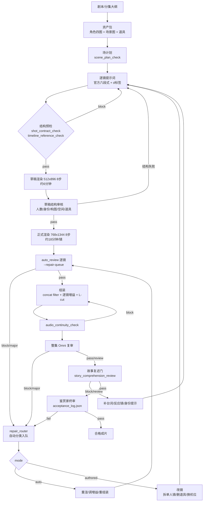
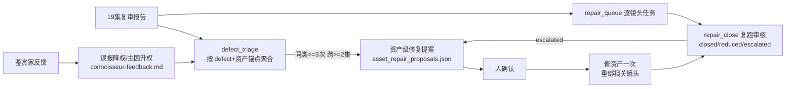

# AI 短剧生产流程图

从剧本到鉴赏家好评的单集闭环，以及跨集的资产级聚合。

## 单集流程（Mermaid）

## 跨集闭环（Mermaid）

## 关键判断点

| 节点 | 通过条件 | 失败去向 |
|---|---|---|
| 结构预检 | 无 block | 回提示词改结构，**不烧 GPU** |
| 草稿审核 | 结构类 pass | 回提示词；细节问题放行到正式 |
| 逐镜复审 | 无 block | 自动路由，auto 直接修，authored 改镜 |
| 音频检查 | 无 blocker | 回组装调增益/改 L-cut |
| 整集复审 | 0 block | 回到对应责任层 |
| 故事复述 | confusions<3 且 clarity/appeal≥6 | 回剧本/分镜补信息 |
| 鉴赏家终审 | pass | 失败回路由，误报写回降权 |

## 硬规则（流程里必须出现）

- 结构失败只能改镜，不允许同一构图渲第三版；
- 带字道具不进特写，可读信息走后期静态图；
- 双人同框不塞交替台词，一人一镜；
- 同一场所有镜头共享同一套角色/场景参考；
- 组装用 concat filter，逐镜增益进 editlist；
- 每个 block/major 必须经 repair_close 复跑确认 closed 才算修完。
